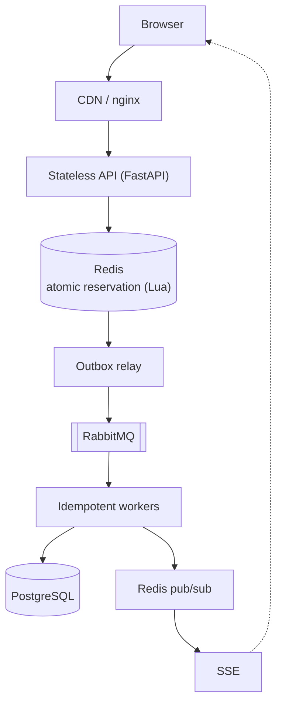

# Flash Sale Platform: The Funnel Principle

Re-architecture of a festival flash-sale checkout (500 units, 100,000+ concurrent requests) that guarantees
**no overselling**, remains responsive under load, and recovers safely from partial failure.

Full design and evaluation: [`docs/SOLUTION_DESIGN.md`](docs/SOLUTION_DESIGN.md).

## Architecture



Each layer reduces traffic for the next; PostgreSQL only ever processes reservation winners.

## Repository layout

| Path | Contents |
|---|---|
| `backend/flashsale/` | API, outbox relay, workers, Redis Lua scripts, schema, bootstrap |
| `backend/tests/` | Unit and Redis integration tests (pytest) |
| `backend/tools/` | System tests and the locking-strategy benchmark |
| `frontend/` | Browser client (JavaScript, required by the browser) and its build with a size budget |
| `gateway/` | nginx configuration: limits, bot filter, balancing, caching, SSE |
| `redis/` | Redis persistence configuration |
| `loadtest/` | k6 script for the 100,000-request burst |
| `docs/` | Design, API reference, operations guide, evidence from executed tests |


## Tests

```powershell
cd backend
pytest                                   # unit and Redis integration tests
python -m tools.race_test                # flash-crowd invariant test (running stack)
python -m tools.lifecycle_test           # payment lifecycle (small sale, see module docstring)
python -m tools.redeliver                # duplicate-delivery idempotency
python -m tools.locking_benchmark        # SELECT/UPDATE vs pessimistic vs optimistic vs atomic vs Redis

cd ..\frontend
npm install
npm test                                 # state-machine tests
npm run build                            # fails if the bundle exceeds 200 KB
npm run lighthouse                       # Time-to-Interactive assertion (requires Chrome)

k6 run -e BASE=http://localhost:8080 loadtest/k6-flash-sale.js
```

## Documentation

| Document | Purpose |
|---|---
|
| [`docs/SOLUTION_DESIGN.md`](docs/SOLUTION_DESIGN.md) | Problem analysis, frontend, backend and database design, verification, traceability |
| [`docs/OPERATIONS.md`](docs/OPERATIONS.md) | Configuration, deployment, runbook, monitoring, security |
| [`docs/evidence/`](docs/evidence) | Captured output of the executed tests and benchmark |
