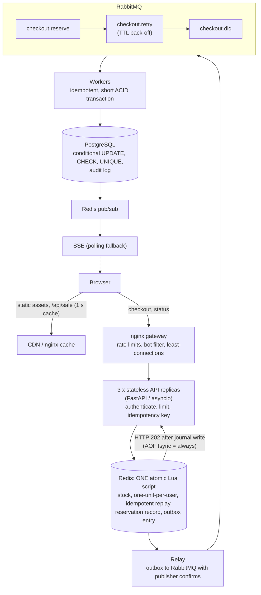
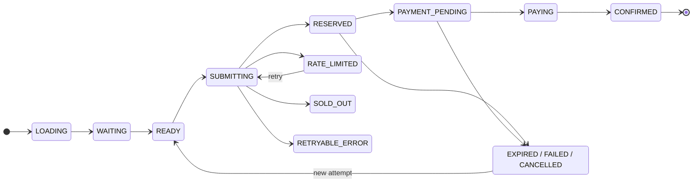

# Flash Sale Re-architecture

**Case:** Festival flash sale of 500 smartphones, 100,000+ concurrent checkout requests in the first 10 seconds
**Scope:** Client, API gateway, application logic, queueing, database and storage

---

## 1. Executive Summary

During trial runs the platform oversold its inventory (540 checkouts for 500 devices), suffered database row-lock
contention and timed out under load. These symptoms share a single cause: the most contended and most expensive
component, the relational database, was asked to make a time-critical inventory decision for every visitor.

The solution applies one rule, the **Funnel Principle**: each layer cheaply reduces the traffic passed to the next,
more expensive layer, so that only reservation winners ever reach PostgreSQL and the payment provider.

| Layer | Responsibility | Traffic reaching the next layer |
|---|---|---|
| CDN / edge cache | Serve static assets and the cached sale status | Dynamic requests only |
| Gateway (nginx) | Per-IP limits, bot filtering, load balancing | Valid, rate-conformant requests |
| API (stateless) | Authentication, per-account limits, idempotency | Authenticated purchase attempts |
| Redis atomic script | One atomic reservation decision | At most 500 active reservations |
| Outbox, RabbitMQ, workers | Durable, asynchronous, idempotent processing | Accepted reservations only |
| PostgreSQL | Authoritative record, independent invariant enforcement | Short ACID transactions |

**Guarantee.** The system guarantees that **no more than 500 units are ever active** (reserved or sold) at any time.
It cannot guarantee that exactly 500 customers complete payment, because customers may abandon or fail payment.
Expired and failed reservations are safely returned to the pool.

---

## 2. Problem Analysis

### 2.1 Check-then-act race condition (cause of the 540/500 oversell)

The legacy flow read the stock, checked it in application code, then updated it in a separate statement:

```sql
SELECT stock FROM inventory WHERE product_id = 42;   -- application checks stock > 0
UPDATE inventory SET stock = stock - 1 WHERE product_id = 42;
INSERT INTO orders (...);
```

The `SELECT` and the `UPDATE` are independent operations. Two requests can both read the final unit as available
before either update commits. At flash-sale concurrency this is not a rare event; it is the normal case.

This was reproduced empirically (Section 6.4): the legacy pattern sold **545 units against a stock of 500** under
2,000 concurrent buyers.

### 2.2 Hot-row contention (cause of lock timeouts)

Every request updates the same inventory row. Row locks serialise those updates; waiting requests hold database
connections, the connection pool is exhausted, and later requests time out without ever reaching the database.

### 2.3 N+1 and chatty query pattern

The legacy checkout issued several round trips per request (product lookup, stock read, existing-order check, stock
update, order insert, confirmation read). At 100,000 requests that is several hundred thousand statements competing
for one pool, and the number of statements grows linearly with traffic. The redesign makes the cost of a **rejected**
request O(1) and database-free, and bounds database work to the number of units for sale.

### 2.4 Synchronous write path

Order creation ran inside the HTTP request, so every visitor paid the database latency, including visitors who
would be told "sold out".

| Symptom | Root cause | Structural correction |
|---|---|---|
| 540 sales for 500 units | Non-atomic read-modify-write | One atomic reservation decision, plus database constraints |
| Row-lock timeouts | Every request contends for one row | Filter requests before any database write |
| API timeouts | Database work inside request/response | Asynchronous queue-based processing |
| Duplicate clicks and retries | No request identity or explicit UI state | Client state machine, server-enforced idempotency |

---

## 3. Architecture



Design rules:

1. **Stateless replicas.** No in-process inventory counters or session affinity; any replica can be replaced.
2. **One reservation path.** Every purchase attempt uses the same atomic script. No alternative endpoint bypasses it.
3. **Defence in depth.** Redis limits admission; PostgreSQL conditional updates and constraints independently protect
   persistent data.
4. **Idempotency at every boundary.** Client key, Redis replay map, unique database keys, idempotent consumers.
5. **Fast, explicit failure.** Sold out, rate limited, unavailable and processing are distinct outcomes; no request hangs.

---

## 4. Frontend Strategy (Client Optimisation)

### 4.1 Preventing request spam: leading-edge lock

The client is an explicit state machine (`frontend/src/machine.js`):



Only `READY` accepts a click. The transition to `SUBMITTING` happens synchronously, before any `await`, so a second
click in the same tick is rejected by the machine. This is a **leading-edge throttle**; a trailing-edge debounce was
rejected because it would delay the single click that matters at sale time. A unit test fires 50 rapid clicks and
asserts exactly one attempt starts.

Every logical attempt carries a UUID `Idempotency-Key` stored in `sessionStorage`. A refresh, a timeout retry or a
retry storm therefore re-sends the same key and can never create a second order.

### 4.2 Graceful loading and failure

| Situation | Client behaviour |
|---|---|
| HTTP 429 / 503 / network error | Exponential back-off with jitter, honours `Retry-After`, same idempotency key, bounded attempts |
| Sold out | Terminal message, "Check availability" action (a released unit can reappear) |
| Reservation expired / payment failed | Explicit message and a "Try again" action using a fresh key |
| Page refresh mid-purchase | `GET /api/me/order` resumes the existing reservation |
| Any wait | Hard 8 s request timeout; no indefinite spinner |

### 4.3 Asset delivery and pre-fetching

- The page shell, hashed JavaScript chunks and critical CSS are served from the CDN/edge with
  `Cache-Control: public, max-age=31536000, immutable` (content-hashed file names); the HTML shell is revalidated.
- Critical CSS is inlined into the HTML, so first paint needs no extra request.
- The checkout module is a **separate code-split chunk**, pre-loaded with `<link rel="modulepreload">` and also
  imported eagerly after boot, so the sale-time click has zero load cost.
- Measured build output: initial transfer **4.4 KB gzip** (HTML + CSS + JS), 5.8 KB including lazy chunks, against the
  200 KB budget. `frontend/build.js` fails the build if the budget is exceeded, and `lighthouserc.json` asserts
  Time-to-Interactive below 1.5 s and total transfer below 200 KB in CI.

### 4.4 Status updates: polling versus SSE versus WebSockets

| Option | Strength | Limitation | Decision |
|---|---|---|---|
| Short polling | Simplest; works everywhere | Repeated requests add load | Fallback with adaptive interval |
| Server-Sent Events | One-way push, automatic reconnect, plain HTTP | Open connection per client | **Primary channel** |
| WebSockets | Full duplex | Heavier connection and operational model | Not needed: order status is one-way |

SSE is served from a per-process Redis pub/sub subscription fan-out. If SSE is unavailable or the server is at its
connection cap, the client falls back to polling at 1, 2, 4 then 5 seconds with jitter, and stops at a terminal state.
A slow safety poll every 15 s guards against a silently stalled stream.

Sale availability is polled with a jittered 4-7 s interval against an endpoint the gateway micro-caches for 1 s, so
100,000 viewers produce roughly one origin request per second per gateway.

### 4.5 Honest optimistic UI

The UI acknowledges the request immediately ("Request received, securing your reservation") but never displays
"Order confirmed" until the backend confirms the order and payment. Every state has a message and a next action.

### 4.6 Clock synchronisation

The countdown uses a server-synchronised clock: the client estimates its offset from `/api/time` using the midpoint of
the round trip, so devices with drifting clocks do not fire early or late. The gateway answers `/api/time` itself.

---

## 5. Backend and Middleware Architecture

### 5.1 Load balancing and bot control

- **nginx** balances with `least_conn` across stateless replicas (no sticky sessions), with keep-alive upstream
  connections, and a retry on another replica for the idempotent checkout call.
- **Layered limits.** Per-IP request limits at the gateway; per-account and per-IP limits inside each replica; an
  optional global admission rate per replica (a lightweight waiting room).
- **Bot filtering.** Empty or scripted user agents receive `403` at the gateway; excessive request rates receive a JSON
  `429` with `Retry-After`. These are baseline measures; production deployments add a managed WAF and bot service in
  front of the CDN.
- **Explicit overload behaviour.** "0% dropped requests" is interpreted as *zero silently lost valid requests*: under
  overload the system returns a clear, machine-readable result (`429`, `503`, `409 SOLD_OUT`) instead of hanging.

### 5.2 Distributed caching layers

| Cache | Purpose |
|---|---|
| CDN / nginx static | Hashed assets and HTML shell |
| nginx micro-cache (1 s) | `/api/sale` availability and start time |
| Redis inventory token | The atomic stock counter and reservation records |
| In-process 250 ms cache | Sale state inside each API replica |

### 5.3 Asynchronous processing: queue and workers

| Criterion | Kafka | RabbitMQ |
|---|---|---|
| Best fit | Durable event streams, replay | Task queues, acknowledgements, retries |
| Operational weight | Heavier | Lighter |
| Fit for 500 events | Over-provisioned | Appropriate |

**Decision:** RabbitMQ. Only up to 500 reservation events enter the pipeline, so either broker has ample capacity;
RabbitMQ offers per-message acknowledgement, TTL-based delayed retry and dead-lettering with less operational overhead.

Pipeline guarantees:

- **Durable acceptance.** The reservation and its outbox entry are written by the *same* Lua call, in a Redis
  configured with `appendfsync always`. Only about 500 calls write, so per-write fsync is inexpensive, while the
  100,000+ rejected requests are pure reads. HTTP `202 Accepted` is returned only after that write.
- **Outbox relay.** A relay publishes entries to RabbitMQ with publisher confirms and removes an entry only after the
  broker acknowledged it. Delivery is at-least-once.
- **Idempotent workers.** A message is acknowledged only after the database transaction commits. Redelivery produces
  no new order and no second stock decrement.
- **Bounded retries.** Failures are retried with exponential back-off through a delay queue, then dead-lettered.
- **Bounded concurrency.** Consumer prefetch limits concurrent database transactions.

### 5.4 Stateless clusters and event-loop safety

The API and workers are Python `asyncio` services. The brief names Node and Go as examples of event-loop runtimes;
the same discipline applies to Python's event loop and is enforced the same way:

- Request handlers perform only awaited, bounded I/O (Redis, RabbitMQ, PostgreSQL via async drivers). No blocking
  call and no CPU-heavy work runs on the loop; token verification is a single constant-time HMAC.
- The checkout handler never waits on a database write.
- In-process state is limited to configuration and a per-second rate counter. Scaling is horizontal.
- Shutdown is graceful (signals handled, connections drained).

---

## 6. Database Consistency and Concurrency Control

###  Strategies compared

| Strategy | Mechanism | Behaviour under flash-sale contention | Verdict |
|---|---|---|---|
| `SELECT` then `UPDATE` | Read, decide in application, write | Race window between read and write; oversells | Unsafe |
| Pessimistic locking | `SELECT ... FOR UPDATE`, then update | Correct; serialises all buyers on one row; connections wait while holding locks | Correct but throughput- and pool-limited |
| Optimistic locking | Update only if `version` unchanged; retry on conflict | Correct; under a single hot row almost every attempt conflicts, producing retry storms and starvation | Poor as the only strategy |
| Conditional atomic `UPDATE` | `UPDATE ... SET stock = stock - 1 WHERE stock > 0` | Correct and atomic, but every buyer still reaches the database | Required as the final safeguard |
| **Redis atomic gate + conditional `UPDATE`** | Decide in memory; persist winners only | Rejected buyers never touch PostgreSQL | **Chosen** |


### Measured comparison

`backend/tools/locking_benchmark.py`: 2,000 concurrent buyers, 500 units, PostgreSQL connection pool of 50
(`docs/evidence/locking_benchmark.txt`).

| Strategy | Sold | Oversold | Time (s) | Buyers reaching DB | DB statements | Retries | Buyers starved |
|---|---|---|---|---|---|---|---|
| 1. SELECT then UPDATE (legacy) | 545 | **45** | 0.91 | 2000 | 3090 | 0 | 0 |
| 2. Pessimistic (`FOR UPDATE`) | 500 | 0 | 1.96 | 2000 | 3000 | 0 | 0 |
| 3. Optimistic (version check) | 500 | 0 | 2.88 | 2000 | 22117 | 9651 | 185 |
| 4. Conditional atomic `UPDATE` | 500 | 0 | 1.23 | 2000 | 2500 | 0 | 0 |
| 5. Redis atomic gate + conditional `UPDATE` | 500 | 0 | 1.52 | **500** | **1000** | 0 | 0 |

Reading the results:

- The legacy pattern oversold, reproducing the incident.
- Pessimistic locking is correct but is the slowest correct approach that does not retry, and holds a database
  connection for every buyer.
- Optimistic locking is correct yet issued almost 9 times the statements of the atomic update, and 185 buyers exhausted
  their retries without receiving an answer: unacceptable for a hot row.
- Strategy 5 reduces database work by 75% in buyers and 60% to 70% in statements. In this single-machine run its wall
  time is comparable to strategy 4 because the benchmark's database is local and uncontended by other workloads; the
  benefit shown is the removal of load from PostgreSQL, which is the resource that failed in production. Absolute
  timings are environment-specific and must be re-measured on target infrastructure.

---

## 7. Reliability, Expiry and Compensation

| Failure | Handling |
|---|---|
| Customer does not pay | Sweeper expires the hold after 10 minutes and returns it to the pool |
| Payment fails or is cancelled | Idempotent transition; database stock and Redis counter restored together |
| Queue publication fails | Entry remains in the Redis outbox; relay retries; reconciler releases holds that never reached the database after expiry plus grace |
| Worker crashes | Transaction rolls back; message is redelivered; no duplicate |
| Duplicate message | Unique keys and consumer deduplication; outcome `DUPLICATE`, state re-synchronised |
| Release interrupted between PostgreSQL and Redis | `redis_synced = FALSE` marks it; the reconciler completes the Redis side |
| Redis loses state | Fails closed (sale reports sold out); reconciler rebuilds from PostgreSQL after queues drain |
| Redis unreachable | API returns `503` with `Retry-After`; client retries with the same key |
| Bot flood | Gateway and in-process limits; per-account cap |
| API replica fails | Orchestrator health checks restart it and the gateway retries on another replica; client retry hits another replica with the same key |

Observability: Prometheus metrics for checkout outcomes and latency, worker outcomes, a database-invariant gauge and a
Redis-drift gauge; an append-only `order_events` audit table; a kill switch (`SET {p42}:paused 1`).

---

## 8. Verification

All results below were produced by the repository's own tools; evidence files are in `docs/evidence/`.

| # | Invariant | Tool | Result |
|---|---|---|---|
| 1 | Atomic script: 200 concurrent users, 5 units | `pytest` (Redis) | Exactly 5 winners; stock never negative; replay and release idempotent; fail-closed when uninitialised |
| 2 | Flash crowd: never more reservations than stock | `tools.race_test` | 3,000 users, 9,000 requests (including retries and a greedy second key): **exactly 500** reservations; PostgreSQL shows 500 active orders, 0 available, 0 duplicate holders, 0 5xx |
| 3 | Same through the gateway | `tools.race_test` via nginx | 1,500 users, 4,500 requests: exactly 500 |
| 4 | Payment lifecycle | `tools.lifecycle_test` | Success, idempotent repeat, failure, cancel, expiry, late payment rejected, released units re-sold once: 12/12 checks pass |
| 5 | Duplicate delivery | `tools.redeliver` | 5 events redelivered: no new orders, no stock change |
| 6 | Redis state loss | manual `DEL` of the counter | Reconciler rebuilt the counter from PostgreSQL |
| 7 | Frontend | `npm test`, `npm run build` | 50 rapid clicks start one attempt (5/5 tests); 4.4 KB gzip against 200 KB |
| 8 | Gateway | nginx | Bot user agents `403`; burst then JSON `429` with `Retry-After`; `X-Cache: HIT` on sale info |
| 9 | Locking strategies | `tools.locking_benchmark` | Section 6.4 |

Not executed in the build environment: a 100,000-request load run (k6 script provided at
`loadtest/k6-flash-sale.js`), Lighthouse TTI measurement (`frontend/lighthouserc.json`), and chaos tests that kill
Redis or workers mid-sale. Throughput observed in the build environment was limited by the single-machine test client
and is not representative of production capacity; capacity must be established with the provided load test on target
infrastructure.

---

## 9. Trade-offs and Limitations

- Redis is not an automatic durable source of truth. Durability depends on its persistence configuration, failover
  design and the reconciliation process. A single Redis instance is a single point of failure; production should use
  a replicated deployment with `WAIT` on the reservation write or accept reconciler-based recovery.
- Temporary reservations reduce immediate sell-through and may release a unit after expiry. This is preferable to
  charging a customer for unavailable stock.
- One unit per customer is an explicit business rule encoded in the script and in the partial unique index.
- A waiting room adds complexity; the included admission limiter is deliberately simple and its rate must be set from
  measured capacity.
- Authentication and payment are demonstration implementations and must be replaced by an identity provider and a
  payment service provider (with webhook verification and payment idempotency keys).
- No architecture can guarantee 100% successful processing during arbitrary infrastructure failure while accepting
  unlimited traffic. The correct behaviour under uncertainty is to fail safely, remain recoverable and never oversell.
